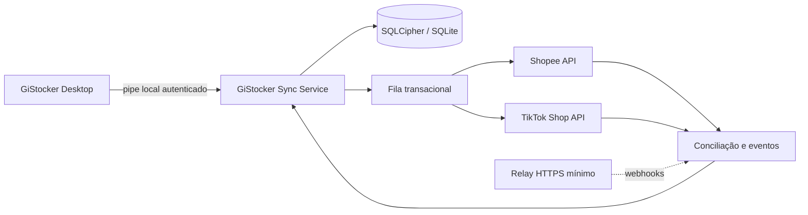

# Proposta para aprovação — GiStocker Multicanal

Data da proposta: 02/10/2026. Este documento define o projeto; não implementa
integrações nem modifica o funcionamento atual do GiStocker.

## 1. Resultado pretendido

O GiStocker passa a ser a autoridade central do estoque de:

- loja física, com movimentações registradas no próprio software;
- Shopee;
- TikTok Shop.

O sistema mantém uma única quantidade física real. As quantidades mostradas nos
marketplaces são cotas calculadas, nunca cópias independentes do mesmo saldo.
Pedidos online, vendas físicas, cancelamentos, devoluções e ajustes alimentam o
mesmo controle e causam novo cálculo das cotas.

Objetivos obrigatórios:

1. priorizar a loja física;
2. impedir que uma venda ou evento seja descontado duas vezes;
3. recuperar automaticamente filas pendentes depois de queda do programa,
   energia ou internet;
4. não depender da interface aberta para sincronizar;
5. manter histórico suficiente para explicar cada alteração;
6. operar inicialmente em uma máquina Windows, com SQLCipher/SQLite local;
7. permitir trocar SQLite por um servidor no futuro sem reescrever as regras.

### Modos de operação

O GiStocker terá um único código e dois modos claramente separados:

1. **Somente estoque físico** — modo padrão de uma instalação nova. Não autoriza
   lojas, não chama APIs e funciona integralmente sem internet. Cadastro, entrada,
   saída, dashboard, relatórios, Admin, segurança e backups permanecem disponíveis.
2. **Estoque multicanal** — habilitado voluntariamente em Configurações >
   Integrações. Abre o assistente de autorização, vínculos, política, simulação e
   ativação gradual. Cada marketplace também possui seu próprio controle.

Estados globais propostos:

```text
FISICO
MULTICANAL_CONFIGURANDO
MULTICANAL_ATIVO
MULTICANAL_PAUSADO
ENCERRANDO_MULTICANAL
```

O motor local usa a mesma regra de transação nos dois modos, evitando duas versões
do estoque. Em `FISICO`, trabalhadores de rede ficam inativos e o banco não precisa
ficar desbloqueado depois que a interface fecha. A chave DPAPI para funcionamento
autônomo só é criada quando o usuário habilita expressamente o modo multicanal.

Ativar não publica estoque imediatamente. O assistente exige autorização, importação
do catálogo, revisão de vínculos, simulação e confirmação do piloto.

Desativar depois de já publicar estoque precisa ser uma operação guiada:

- **Pausar:** interrompe novas publicações, preserva tokens e mantém a última
  exposição como comprometida; apropriado para manutenção curta;
- **Encerrar com segurança — recomendado:** bloqueia redistribuições, envia zero aos
  anúncios geridos, confirma o valor remoto, importa pedidos pendentes, revoga/remove
  autorizações e então muda para `FISICO`;
- **Transferir para controle manual:** exporta o estado, exige confirmação explícita
  do operador e deixa claro que os marketplaces passam a ser responsabilidade dele.

Um botão não pode simplesmente parar o serviço enquanto ainda houver unidades
anunciadas, pois essas unidades continuariam vendendo sem baixa local.

## 2. Regra inicial de distribuição

Política padrão proposta: **50% reservados para a loja física**. Os outros 50%
são distribuídos entre os canais de e-commerce ativos por pesos configuráveis. Com
Shopee e TikTok Shop usando o mesmo peso, a divisão nominal fica 50%/25%/25%.

Exemplo com 10 unidades livres:

| Destino | Quantidade-alvo |
| --- | ---: |
| Loja física | 5 |
| Shopee | 3 |
| TikTok Shop | 2 |

O cálculo reserva para a loja física `ceil(saldo_livre * 0,50)`. O restante usa o
método de maiores restos conforme o peso de cada canal elegível. Quando houver uma
unidade indivisível e os pesos forem iguais, o canal é sorteado. Esse sorteio é
**persistente**: o resultado fica gravado e não muda em toda sincronização. Um novo
sorteio só ocorre quando surge uma nova unidade indivisível, a anterior é vendida ou
a elegibilidade dos canais muda. No exemplo, a Shopee recebeu a unidade ímpar.

### Elegibilidade de produto por canal

Um canal participa do cálculo de um produto somente quando todos os itens abaixo
forem verdadeiros:

- a loja está autorizada e ativa;
- existe vínculo confirmado entre o produto local e o SKU/variação remoto;
- anúncio e armazém aceitam atualização de estoque;
- não existe incidente que exija pausa daquele vínculo.

Se Malbec Gold estiver vinculado somente à Shopee, toda a cota destinada ao
e-commerce vai para a Shopee. O TikTok recebe zero e nenhuma chamada é feita para um
produto inexistente nele. Se o produto não estiver vinculado a nenhum marketplace,
todo o saldo permanece apenas disponível no físico.

Ausência estrutural de anúncio é diferente de falha temporária. Se um produto está
cadastrado no TikTok, mas a API está fora do ar, sua última exposição confirmada
continua comprometendo saldo. O sistema não entrega essas mesmas unidades à Shopee
até confirmar que foram retiradas do TikTok.

Definições:

- **em mãos**: unidades fisicamente existentes;
- **comprometido**: pedido aceito/reservado que ainda não concluiu seu ciclo;
- **quarentena**: devolução ou item com condição ainda não conferida;
- **livre**: `em mãos - comprometido - quarentena`;
- **exposição confirmada**: última quantidade que cada marketplace confirmou;
- **quantidade desejada**: cota que o GiStocker quer publicar agora.

Os percentuais incidem sobre o saldo livre. Uma unidade comprometida por pedido
não pode ser retirada para recompor a porcentagem da loja física.

### Prioridade física sem quebra de estoque

Há um limite inevitável: entre uma venda física e a confirmação da redução nos
marketplaces existe uma janela de comunicação. A garantia mais forte requer a
regra abaixo, chamada **modo estrito**:

```text
venda física permitida somente se
saldo após a venda >= exposição online ainda confirmada + margem de segurança
```

Enquanto a loja vende dentro das unidades reservadas a ela, a venda é imediata.
Se quiser usar uma unidade ainda exposta online, o sistema primeiro reduz/zera a
exposição necessária, aguarda confirmação e então libera a venda física. Sem
internet, essa transferência fica bloqueada. Assim a loja física tem a maior cota
e recebe primeiro as unidades novas, mas não promete online uma unidade já vendida.

Um **modo rápido** poderia concluir a venda antes da confirmação remota, mas teria
risco residual de duas compras simultâneas. Ele não é recomendado como padrão.

Margem de segurança proposta para o piloto: configurável por produto, inicialmente
zero para reproduzir a política de 50% de reserva física. Para produção, recomenda-se
avaliar uma unidade oculta em produtos de giro alto ou saldo baixo.

Quando o saldo for muito pequeno, a loja física é favorecida:

| Saldo livre | Física | E-commerce total |
| ---: | ---: | ---: |
| 1 | 1 | 0 |
| 2 | 1 | 1 |
| 3 | 2 | 1 |
| 5 | 3 | 2 |
| 10 | 5 | 5 |

## 3. Arquitetura recomendada



### GiStocker Desktop

Continua sendo a interface usada pela loja. Cadastro, entrada, saída, consulta e
ajuste passam a enviar comandos ao serviço local. A interface não grava mais o
banco diretamente. Bloquear ou fechar a tela não interrompe a sincronização.

### GiStocker Sync Service

Serviço do Windows iniciado automaticamente e executado sob uma conta local
dedicada. É o único escritor do banco e responsável por:

- validar e registrar comandos da interface;
- importar pedidos e eventos;
- calcular cotas;
- persistir comandos de atualização antes de chamar as APIs;
- renovar autorizações;
- repetir falhas com espera progressiva e variação aleatória;
- conciliar pedidos e estoques periodicamente;
- publicar estado de saúde para o painel.

Esse desenho mantém as transações curtas: nenhuma transação SQLite fica aberta
durante uma chamada de rede.

No modo `FISICO`, o serviço atua apenas como núcleo local e permanece sem tarefas de
rede. No modo multicanal, os trabalhadores de integração continuam ativos mesmo com
a interface fechada.

### Comunicação local

Recomenda-se Named Pipe do Windows com ACL restrita à conta do serviço e ao usuário
autorizado. Cada sessão da interface recebe um token efêmero depois do login.
Isso impede que outra aplicação local envie comandos apenas por conhecer uma porta.

### Webhooks

Um serviço estritamente local atrás do roteador não possui, normalmente, um endereço
HTTPS público estável para receber webhooks. Há três alternativas:

1. **Relay mínimo na nuvem — recomendado:** recebe, valida e guarda notificações;
   o serviço local busca os eventos. O estoque e o banco permanecem locais.
2. **Somente consultas periódicas:** totalmente local, porém menos imediato e pode
   não atender requisitos de aprovação de um aplicativo conector.
3. **Expor a máquina local à internet:** descartado para o piloto pelo risco e pela
   dependência de IP, certificado, firewall e disponibilidade do computador.

Webhook serve como aviso rápido; a conciliação periódica continua obrigatória,
pois notificações podem atrasar, duplicar ou chegar fora de ordem.

## 4. Chaves, senha e funcionamento após reinício

O banco atual usa diretamente a senha informada pelo usuário. Nesse formato, um
serviço não consegue abrir o banco sozinho depois de queda de energia. Para cumprir
o requisito de recuperação 24 horas, propõe-se:

1. gerar uma chave aleatória de dados de 256 bits;
2. criptografar o banco SQLCipher com essa chave;
3. guardar uma cópia da chave embrulhada pela senha do usuário;
4. guardar outra cópia embrulhada pelo DPAPI do Windows, vinculada à conta dedicada
   do serviço e às permissões da máquina;
5. nunca gravar a chave aberta, a senha ou tokens em arquivos de configuração.

A senha continua sendo necessária para uma pessoa abrir a interface. O serviço
consegue retomar sozinho na mesma máquina. Copiar a pasta para outro computador não
leva a autorização automática: será necessário recuperar com a senha e autorizar
novamente as lojas.

Esse modo altera o limite de segurança: um administrador do Windows ou malware que
controle a conta do serviço pode tentar usar o acesso automático. Isso é inerente a
qualquer serviço local que precise trabalhar sem alguém digitar uma senha. Conta
dedicada, ACL, DPAPI, atualização do Windows, antimalware e BitLocker continuam sendo
camadas necessárias.

Backups portáteis deverão usar um contêiner próprio, contendo o banco cifrado e a
chave de dados embrulhada pela senha do usuário. O embrulho DPAPI não deve ser a
única forma de recuperação.

Credenciais Shopee/TikTok não entram no executável. Tokens renováveis e segredos
ficam cifrados e protegidos pela conta do serviço. Logs ocultam tokens, assinaturas,
dados do comprador e conteúdo sensível.

### Uso próprio e distribuição para outros lojistas

Há duas situações diferentes:

- **integração somente das lojas do proprietário:** credenciais de uma aplicação
  privada podem ficar no cofre local, protegidas por DPAPI, aceitando o limite de que
  um administrador da própria máquina controla o processo autorizado;
- **build distribuída com integração para várias pessoas:** o segredo compartilhado
  do aplicativo não pode ser embutido no executável. Um usuário pode analisar a build
  e extraí-lo. Nesse cenário, recomenda-se um broker HTTPS mínimo para troca/renovação
  de tokens, assinatura e webhooks; banco, saldos, regras e filas continuam locais.

Como alternativa ao broker, cada cliente teria de registrar sua própria aplicação de
desenvolvedor e informar credenciais próprias, o que é pouco prático. A escolha entre
uso privado e produto multicliente deve ocorrer antes de implementar autorização.

**Decisão para a primeira implantação:** o projeto atual será `SINGLE_TENANT`, para
um único lojista e suas próprias contas autorizadas. A integração usará aplicação
privada/própria quando a plataforma e o mercado permitirem. Credenciais nunca serão
gravadas no fonte: serão provisionadas depois da instalação e protegidas pelo cofre
local do Windows. O risco residual de um administrador ou malware na própria máquina
fica limitado às lojas desse lojista.

Um relay mínimo continua opcionalmente necessário se a plataforma exigir callback
HTTPS público ou webhooks. Isso não transforma o sistema em multicliente e não muda
a autoridade local do estoque.

### Edições futuras por lojista

Versões adaptadas não devem virar cópias independentes do repositório. O desenho será:

```text
Núcleo GiStocker comum e atualizado
    + perfil assinado do lojista
    + módulos habilitados
    + identidade visual
    + políticas de estoque
    + conectores autorizados
```

O perfil pode selecionar modo físico ou multicanal, canais, percentuais, margem,
recursos e marca. Ele não contém `app_secret`, tokens ou chave do banco. Correções de
segurança, migrações e testes permanecem no núcleo único e chegam a todas as edições.

Quando houver vários lojistas usando integração online, o modelo evolui para broker
multicliente, isolamento por tenant e credenciais separadas. Essa evolução não exige
trocar o modelo de estoque local nem os vínculos de SKU.

### Proteção da build e dos segredos

A distribuição atual usa PyInstaller. Ele empacota bytecode Python, bibliotecas e
recursos em vez de transformar toda a aplicação em código nativo irrecuperável. Um
terceiro pode extrair partes, reconstruir lógica aproximada e localizar strings ou
segredos fixos. O código-fonte original, comentários e formatação não são recuperados
necessariamente, mas PyInstaller não é uma barreira de confidencialidade.

O projeto separará duas proteções:

1. **Segredos:** nenhum `app_secret`, chave de parceiro, token mestre ou chave de
   assinatura compartilhada entra no repositório, instalador ou executável. No modo
   multicliente, o broker guarda esses segredos em cofre de servidor e oferece apenas
   operações restritas; ele nunca funciona como um assinador genérico de qualquer
   URL/payload solicitado pelo cliente.
2. **Propriedade intelectual:** módulos próprios serão avaliados para compilação
   nativa com Nuitka/Cython, remoção de símbolos de depuração e minimização de strings
   sensíveis. Isso aumenta o custo da engenharia reversa, sem prometer impossibilidade.

Cada instalação multicanal terá identidade própria:

- par de chaves do dispositivo criado no Windows CNG/TPM quando disponível;
- chave privada não exportável, com DPAPI como fallback;
- registro do dispositivo vinculado à loja autorizada;
- requisições com nonce, timestamp, chave idempotente e assinatura do dispositivo;
- tokens de sessão curtos e limitados a canal, loja e operação;
- revogação individual sem trocar credenciais de todos os clientes.

O broker valida loja, instalação, operação, SKU e limites antes de chamar a API. Ele
aplica rate limit, proteção contra replay e auditoria sem tokens. Segredos globais
ficam em KMS/cofre equivalente, com rotação e separação por ambiente.

Releases serão assinadas digitalmente. O atualizador verifica assinatura e hash do
manifesto/pacote antes de instalar. A esteira de build executa varredura de segredos
no código e no artefato, gera inventário de dependências e reprova qualquer arquivo
que contenha credenciais de produção.

Compilação nativa, ofuscação e anti-tamper são camadas auxiliares. A garantia de que
um segredo compartilhado não seja obtido da build vem da sua ausência na build.

## 5. Modelo de dados proposto

As tabelas atuais (`Produtos`, `Codigos_Barras`, `Logs_Movimentacao`) são preservadas
durante a migração. A versão do esquema sobe por migrações transacionais.

| Tabela nova | Finalidade |
| --- | --- |
| `Canais` | Loja física, Shopee e TikTok, estado, prioridade e configuração. |
| `Lojas_Externas` | Conta autorizada, região, status do token e referência segura da credencial. |
| `Vinculos_SKU` | Produto/variação local ↔ produto, SKU e armazém externos. |
| `Cobertura_Produto_Canal` | Situação explícita: pendente, vinculado, não publicado, ignorado ou pausado. |
| `Politicas_Alocacao` | Percentuais, margem, modo estrito e substituições por produto. |
| `Eventos_Estoque` | Razão imutável de cada delta, origem, chave idempotente e evento revertido. |
| `Reservas` | Quantidade comprometida por pedido e seu estado. |
| `Pedidos_Externos` | Identificador, canal, loja, estado, versão e datas do pedido. |
| `Itens_Pedido_Externo` | Linha/SKU, produto local, quantidade e valor relevante. |
| `Inbox_Eventos` | Eventos recebidos; chave externa única impede processamento duplicado. |
| `Outbox_Comandos` | Atualizações que devem ser enviadas depois do commit local. |
| `Estado_SKU_Canal` | Quantidade desejada, enviada, confirmada e observada remotamente. |
| `Estado_Alocacao` | Canal sorteado para sobras indivisíveis e geração vigente da cota. |
| `Cursores_Sincronizacao` | Janelas de consulta, paginação e última conciliação concluída. |
| `Incidentes_Sync` | SKU sem vínculo, divergência, credencial vencida e falhas definitivas. |
| `Componentes_Kit` | Kit local e quantidade necessária de cada componente. |

`Produtos.estoque_atual` continua sendo uma projeção rápida do saldo físico. Toda
alteração multicanal cria um `Evento_Estoque`; a atualização da projeção e a inclusão
na outbox acontecem na mesma transação.

O histórico deixa de desfazer ações apagando efeitos. Uma correção cria um evento
compensatório. O atual botão Desfazer precisará verificar pedidos/reservas e poderá
ser bloqueado quando a movimentação já tiver consequências externas.

### Produtos, variações e kits

GTIN ajuda na conferência, mas não substitui o vínculo de SKU. Cada variação e cada
armazém remoto precisam ser associados explicitamente.

Para kits, `Componentes_Kit` define a composição. A disponibilidade do kit é:

```text
mínimo, entre os componentes, de
parte_inteira(disponível_do_componente / quantidade_exigida)
```

Uma venda do kit reserva/baixa os componentes em uma só transação e recalcula tanto
o anúncio do kit quanto os anúncios unitários que usam os mesmos componentes.
Kit não pode ser ativado online até toda a composição estar validada.

## 6. Fluxo de uma venda online

1. Webhook acorda o serviço ou a consulta periódica encontra o pedido.
2. O payload bruto recebe hash, canal, loja e identificador único em `Inbox_Eventos`.
3. O serviço busca os detalhes atuais do pedido na API; não confia só no webhook.
4. Para cada linha, resolve o vínculo de SKU. SKU desconhecido abre incidente.
5. A máquina de estados decide se aquele estado cria, mantém ou libera reserva.
6. Uma transação registra pedido, reserva/evento, novo saldo e comandos na outbox.
7. O alocador recalcula as quantidades absolutas dos outros canais.
8. O trabalhador envia a quantidade absoluta, registra a resposta e consulta o
   valor remoto quando a confirmação for incerta.
9. A conciliação posterior confirma que pedido, reserva e estoque convergiram.

Chave idempotente mínima: plataforma + loja + pedido + linha + transição/versão.
Receber o mesmo evento novamente não gera nova baixa.

O cancelamento é tratado por item e por estado:

- cancelado antes de separação: libera a reserva automaticamente e recalcula cotas;
- cancelado durante/depois da separação, mas antes do envio: vai para conferência
  local; após o item retornar à prateleira, a reserva é liberada;
- enviado: não retorna ao saldo por simples cancelamento ou notificação;
- devolvido: entra em quarentena e só volta ao vendável após inspeção física.

Para distinguir esses casos, o pedido terá estado da plataforma e estado operacional
local (`NOVO`, `RESERVADO`, `EM_SEPARACAO`, `EMBALADO`, `ENVIADO`, `CANCELADO`,
`DEVOLUCAO_EM_CONFERENCIA`). Eventos repetidos ou cancelamentos parciais usam a
mesma chave idempotente e não liberam quantidade duas vezes.

## 7. Envio de estoque aos marketplaces

São enviados valores absolutos, não operações “somar/subtrair”. Isso torna uma
repetição segura e permite convergir depois de timeout incerto.

Múltiplas mudanças rápidas do mesmo SKU são condensadas: a outbox preserva o maior
número de geração e envia o valor desejado mais recente. O histórico das causas não
é condensado.

Estados do comando:

```text
PENDENTE → ENVIANDO → CONFIRMADO
                  ↘ RETENTAR → PENDENTE
                  ↘ INCIDENTE (erro permanente ou limite excedido)
```

Retentativas usam espera exponencial com jitter. Erros de autorização param o canal
e pedem reautorização. Erros de limite aguardam a janela informada pela plataforma.
Erros de validação vão para incidente; não são repetidos indefinidamente.

Intervalos iniciais, ajustáveis aos limites reais das APIs:

- eventos/outbox: imediatamente;
- pedidos atualizados: a cada 30–60 segundos, com sobreposição da janela;
- comparação de estoque remoto: a cada 10–15 minutos;
- auditoria completa de pedidos/SKUs: uma vez por noite e na inicialização;
- renovação de token: antes do vencimento, nunca no último minuto.

## 8. Falhas e recuperação

### Internet indisponível

O serviço mantém a outbox e continua registrando vendas físicas. No modo estrito,
a disponibilidade física máxima usa a última exposição online confirmada. Se a
venda invadir unidades ainda prometidas online, ela é bloqueada até reconectar.

### Queda de energia ou processo encerrado

Transação confirmada permanece; transação incompleta é revertida pelo SQLite.
Ao reiniciar, o serviço usa DPAPI, recupera comandos `PENDENTE/ENVIANDO`, consulta
o estado remoto em envios de resultado incerto e faz conciliação antes de liberar
transferências de cota.

### Marketplace indisponível

O outro canal não recebe unidades que dependam da retirada ainda não confirmada no
canal indisponível. A política favorece reduzir exposição, nunca duplicá-la.

### Evento duplicado ou fora de ordem

O identificador único evita nova baixa. Versão/horário remoto não pode regredir a
máquina de estados. Casos incompatíveis viram incidente para revisão humana.

### SKU sem vínculo

Não se inventa correspondência por nome ou GTIN. O sistema alerta, suspende o SKU
envolvido quando a API permitir e exige vínculo manual antes de continuar.

### Divergência física

Contagem ou ajuste manual registra evento de inventário e dispara conciliação. O
sistema mostra a diferença antes de republicar, especialmente se houver pedidos.

## 9. Telas propostas

### Integrações

- cartões Shopee/TikTok: conectado, degradado, pausado ou reautorização necessária;
- última comunicação, última conciliação, fila pendente e incidentes;
- conectar/reautorizar loja por autorização oficial no navegador e pausar com efeito explícito;
- botão de conciliação manual e diagnóstico sem exibir segredos.

### Vínculos de SKU

- produto/kit local, canal, anúncio, variação, armazém e SKU externo;
- sugestão por GTIN apenas para conferência; confirmação humana obrigatória;
- bloqueio de duplicidade e checklist antes de ativar.

O operador não digita IDs técnicos. Depois da autorização, o GiStocker importa o
catálogo da loja em modo somente leitura e mostra duas listas lado a lado: produtos
locais e anúncios/variações remotos. Cada item remoto exibe imagem, título, variação,
SKU do vendedor, GTIN quando existir, estoque observado e canal. Ao confirmar uma
associação, o sistema grava os IDs retornados pela API.

Exemplo conceitual:

```text
Produto local #42 — Refil Lily — GTIN 789...
  ↔ Shopee: loja A / item 9988 / variação 7766
  ↔ TikTok: loja B / produto 5544 / SKU 3322 / armazém 11
```

O produto local continua sendo `Produtos.id = 42`. Os números externos não precisam
existir no cadastro local antes da importação e não são digitados pelo usuário.

Sugestões de vínculo seguem níveis de confiança:

1. GTIN exato e único;
2. SKU do vendedor igual a um identificador GiStocker previamente publicado;
3. marca, nome, volume e variação normalizados;
4. similaridade textual, somente como opção de busca.

Os níveis 3 e 4 nunca vinculam automaticamente. Mesmo o GTIN exato entra numa fila
de confirmação em lote antes da primeira publicação, pois embalagem, kit ou cadastro
remoto incorreto podem compartilhar um código inadequado.

Cada SKU remoto só pode apontar para um produto local. Um produto local pode apontar
para Shopee e TikTok e também para mais de um anúncio intencional. Quando houver dois
anúncios do mesmo produto dentro do mesmo canal, a soma das exposições desses anúncios
não pode superar a cota daquele canal.

Por produto e canal, a cobertura será uma destas:

- `PENDENTE_VINCULO`: anúncio encontrado ou situação ainda não revisada; não ativa;
- `VINCULADO`: SKU confirmado e elegível;
- `NAO_PUBLICADO`: confirmado que o produto não existe nesse canal;
- `IGNORADO`: anúncio existe, mas fica explicitamente fora da gestão do GiStocker;
- `PAUSADO`: vínculo existe, porém está temporariamente suspenso.

Um anúncio ativo e ignorado ainda pode vender fora do controle central. O monitor
mantém esse risco visível e não declara o produto “protegido” enquanto houver anúncio
com estoque não vinculado ou não zerado.

### Política de estoque

- padrão global de 50% de reserva física e pesos iguais no e-commerce;
- substituição por produto/categoria;
- margem de segurança e modo estrito;
- simulador “com saldo X, será publicado Y em cada canal”;
- histórico de alteração da política.

### Monitor de sincronização

- desejado, enviado, confirmado e observado por SKU/canal;
- pedidos importados e reservas;
- retentar, reconhecer/resolver incidente e exportar diagnóstico sanitizado;
- alerta visível quando o serviço não responde.

### Dashboard/Produto

- estoque físico, comprometido, quarentena e livre;
- reserva da loja, Shopee e TikTok;
- última sincronização e divergências;
- componentes e disponibilidade calculada dos kits.

## 10. APIs e autorização

TikTok Shop documenta atualização de inventário por produto/SKU/armazém e exige o
escopo `seller.product.write`. A consulta de pedidos exige `seller.order.info` (ou
escopo de fulfillment aplicável). Aplicativos conectores sincronizam loja, produto,
estoque, preço e pedidos; a documentação indica revisão correspondente ao tipo do
aplicativo. Webhooks precisam de endpoint HTTPS configurado separadamente.

Na Shopee, a implantação depende de Partner App, autorização da loja, tokens e dos
escopos/endpoints liberados para a conta e mercado. A disponibilidade exata no Brasil,
limites, estados de pedido, eventos e processo de aprovação devem ser confirmados no
Open Platform autenticado antes do conector. O projeto não dependerá de automação de
tela, scraping ou credenciais de usuário/senha do Seller Center.

Não se deve codificar versões/endpoints de exemplo como permanentes. Cada adaptador
terá versão declarada, testes contratuais e acompanhamento de changelog. O TikTok
informa que versões antigas podem ter janela mínima curta após uma nova versão.

Referências oficiais consultadas:

- [TikTok Shop — Update Inventory](https://partner.tiktokshop.com/docv2/page/update-inventory)
- [TikTok Shop — Get Order List](https://partner.tiktokshop.com/docv2/page/get-order-list-202309)
- [TikTok Shop — OMS e conectores](https://partner.tiktokshop.com/docv2/page/order-management-system-oms)
- [TikTok Shop — SDK e configuração de webhooks](https://partner.tiktokshop.com/docv2/page/tts-api-sdk-overview)
- [TikTok Shop — versionamento](https://partner.tiktokshop.com/docv2/page/api-versioning)
- [TikTok Shop — revisão de aplicativo](https://partner.tiktokshop.com/docv2/page/app-review-process)
- [Shopee Open Platform](https://open.shopee.com/)

## 11. Etapas de execução

### Etapa 0 — validação externa e inventário

- confirmar contas, país, tipo de vendedor e acesso de desenvolvedor;
- obter documentação autenticada, ambientes de teste, escopos e limites;
- exportar lista de anúncios/variações/armazéns sem alterar estoque;
- escolher 5–10 produtos simples, sem kits, para o piloto;
- registrar estados de pedido que reservam/liberam estoque em cada canal.

**Saída para aprovação:** matriz de capacidades e riscos reais por plataforma.

### Etapa 1 — fundação local, sem conexão externa

- migrações versionadas e backup/restauração testados;
- serviço do Windows, pipe local e novo cofre de chaves;
- eventos, reservas, inbox, outbox e incidentes;
- adaptar operações atuais ao serviço sem mudar o resultado funcional;
- modo simulador, sem enviar nada às lojas.

**Aceite:** todas as funções atuais passam; desligamentos simulados não perdem ou
duplicam uma operação; interface fechada não encerra o serviço.

### Etapa 2 — alocador e telas, ainda em simulação

- reserva física de 50%, pesos do e-commerce, arredondamento, margem e políticas por produto;
- exposição confirmada e bloqueio físico estrito;
- mapeamento de SKU, monitor e alertas;
- replay de cenários gravados com milhares de combinações e concorrência.

**Aceite:** para qualquer cenário, soma publicada/comprometida nunca supera o
estoque permitido; toda decisão é explicável no histórico.

### Etapa 3 — primeiro marketplace em loja de teste

Recomendação: escolher o canal cuja aprovação e sandbox estejam disponíveis
primeiro. Implementar autorização, produtos/SKUs, pedidos, inventário, webhook/relay,
polling e conciliação. Começar somente leitura; depois habilitar estoque em poucos SKUs.

**Aceite:** 7 dias de sombra comparando sem publicar, seguidos por piloto controlado;
zero baixa duplicada e zero divergência não explicada.

### Etapa 4 — primeiro marketplace em produção limitada

- 5–10 SKUs, horário acompanhado e botão de pausa;
- margem conservadora e alertas imediatos;
- procedimento documentado de retorno ao controle manual;
- ampliar somente depois de uma janela estável definida.

### Etapa 5 — segundo marketplace

Adicionar o adaptador restante usando o mesmo domínio, inbox/outbox e monitor.
Executar sombra e piloto novamente. Só então ativar redistribuição entre canais.

### Etapa 6 — kits e operação avançada

Composição, reservas atômicas de componentes, devoluções/quarentena, várias lojas ou
armazéns, políticas por produto e relatórios multicanal.

## 12. Testes e critérios de liberação

Obrigatórios antes de produção:

- propriedades do alocador para saldos 0 até o limite inteiro;
- duas vendas simultâneas em canais diferentes;
- evento repetido 100 vezes produzindo uma única reserva;
- eventos fora de ordem e cancelamento tardio;
- timeout antes/depois da plataforma aplicar uma atualização;
- falhas em cada ponto de commit e reinício;
- internet ausente por horas, token vencido e limite de API;
- banco ocupado, disco cheio e relógio local incorreto (uso interno em UTC);
- SKU sem vínculo, vínculo duplicado e produto removido/desativado;
- kit e unidade concorrendo pelos mesmos componentes;
- backup/restauração em outra máquina com senha;
- teste de contrato contra ambiente oficial;
- carga superior ao catálogo e pico de pedidos esperados;
- logs sem tokens, assinaturas ou dados pessoais desnecessários;
- rollback documentado para voltar temporariamente ao controle manual.

Indicadores de produção:

- atraso entre pedido e reserva local;
- atraso entre cálculo e confirmação remota;
- divergências por SKU/canal;
- idade da tarefa mais antiga;
- taxa de retentativas/erros e validade dos tokens;
- serviço, banco, internet e relay saudáveis.

## 13. Uso de SQLite

SQLite/SQLCipher é adequado para o piloto em uma máquina porque o serviço será o
único escritor, as transações serão curtas e haverá fila persistente. O arquivo não
deve ser colocado em pasta de rede, OneDrive ou Dropbox.

Reavaliar PostgreSQL ou serviço central quando houver:

- duas ou mais máquinas gravando no mesmo estoque;
- várias lojas físicas trabalhando simultaneamente;
- necessidade de alta disponibilidade sem depender do PC local;
- volume em que conciliações/filas prejudiquem a interface;
- equipe remota ou múltiplos serviços escrevendo diretamente.

A camada de repositórios e os casos de uso serão separados do SQLite para permitir
essa troca. Não haverá duas bases independentes concorrendo como autoridade.

## 14. Decisões solicitadas para aprovação

Recomendação inicial do projeto:

| Decisão | Proposta |
| --- | --- |
| Autoridade | GiStocker local é a fonte central do saldo. |
| Modo inicial | Somente estoque físico, sem chamadas de rede. |
| Escopo inicial | Single-tenant: um lojista, com contas próprias autorizadas. |
| Edições futuras | Mesmo núcleo com perfis e módulos; sem forks independentes por cliente. |
| Ativação | Voluntária, por assistente e piloto; não publica ao ligar o botão. |
| Desativação | Fluxo seguro com zeragem/transferência; nunca apenas encerrar o sincronizador. |
| Distribuição | 50% física; os 50% restantes entre os canais elegíveis. |
| Sobra indivisível | Sorteio persistente entre canais elegíveis; nunca sortear novamente em cada ciclo. |
| Produto ausente em canal | Canal sem vínculo recebe zero; a cota online vai aos canais elegíveis. |
| Garantia | Modo estrito; venda física não invade exposição online não retirada. |
| Margem inicial | 0 no simulador; avaliar 1 unidade no piloto de alto giro. |
| Infraestrutura | Serviço Windows + SQLCipher/SQLite, um único escritor. |
| Reinício autônomo | Serviço Windows em segundo plano + chave aleatória embrulhada por senha e DPAPI. |
| Cancelamento | Antes da separação libera automaticamente; demais estados exigem conferência apropriada. |
| Eventos externos | Relay HTTPS mínimo + polling/conciliação local. |
| Implantação | Um marketplace e 5–10 SKUs antes do segundo canal. |
| Kits | Somente depois do fluxo unitário estabilizado. |
| Publicação | Somente APIs oficiais e aplicativo autorizado. |

Antes de iniciar código, ainda será necessário escolher:

1. qual marketplace será o primeiro piloto;
2. aceitar ou rejeitar o relay mínimo na nuvem;
3. confirmar o modo estrito;
4. definir a margem padrão de segurança;
5. indicar se já existem kits que compartilham estoque com produtos unitários;
6. confirmar se haverá uma ou mais contas/lojas em cada plataforma;
7. definir como o operador marca no GiStocker que começou a separar um pedido;
8. se no futuro for multicliente, aceitar um broker mínimo ou exigir que cada cliente possua
   credenciais próprias de desenvolvedor.

## 15. O que não será feito nesta fase

- não alterar preços, títulos, anúncios, fretes ou pedidos sem escopo aprovado;
- não armazenar senha do Seller Center;
- não usar scraping ou automação visual como integração;
- não ativar todos os produtos de uma vez;
- não permitir edição direta do saldo nos marketplaces sem gerar conflito/alerta;
- não prometer operação 24 horas se o computador, internet e relay estiverem fora;
- não tratar uma resposta HTTP isolada como prova permanente de sincronização.

Após a aprovação desta proposta, a primeira entrega deve ser a **Etapa 0**, seguida
da fundação local em modo simulado. Nenhuma credencial real deve entrar no código,
nos testes ou na conversa.
